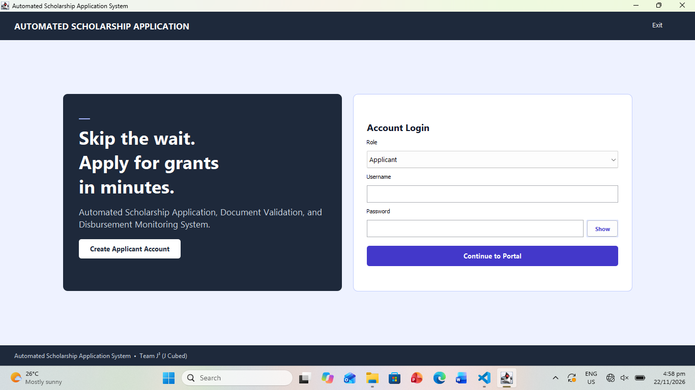
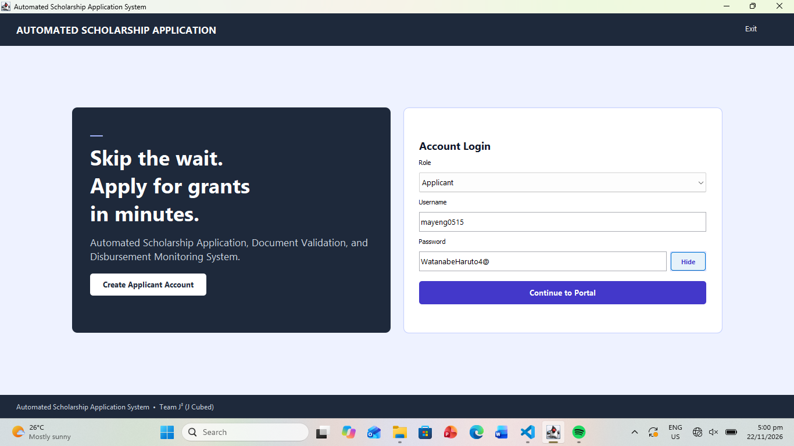
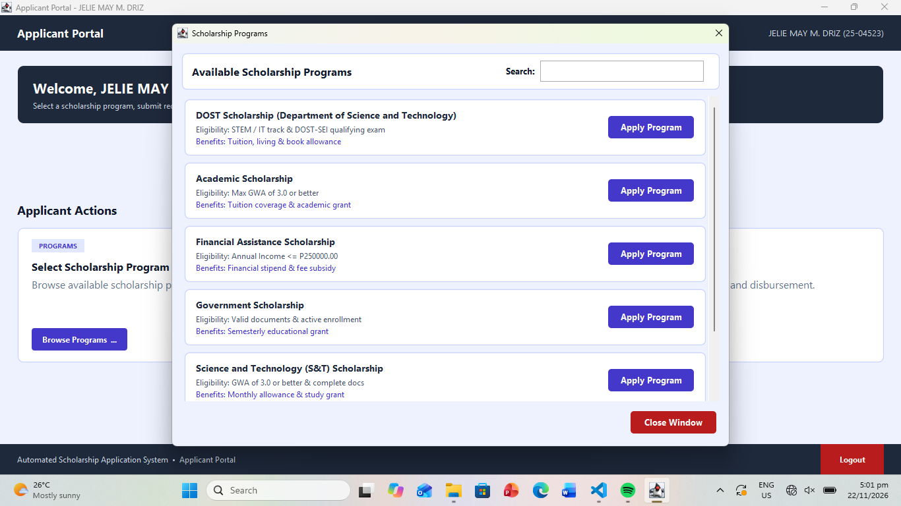
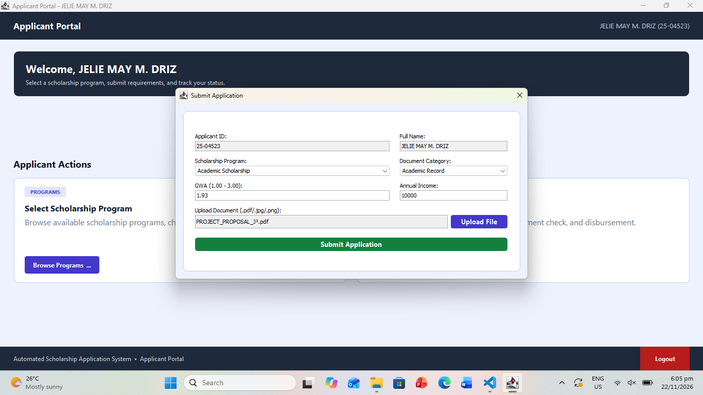
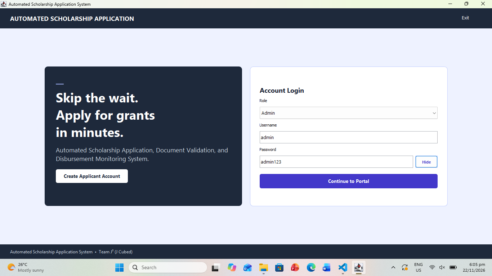
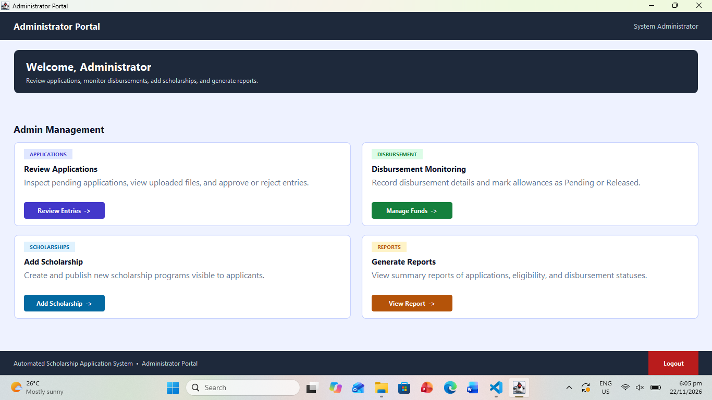
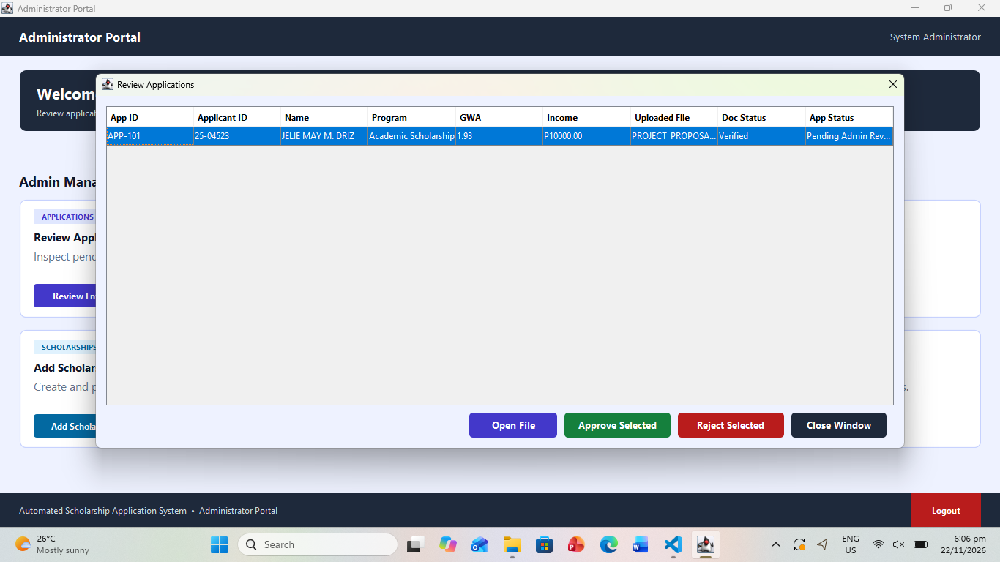
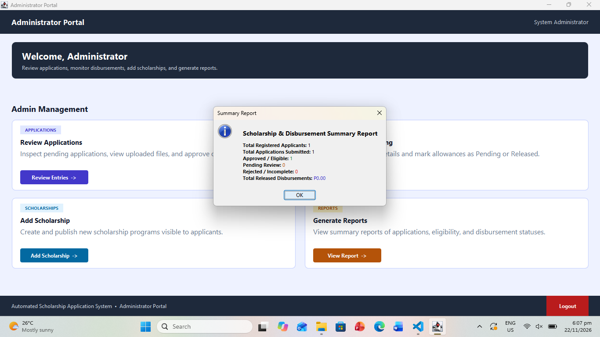
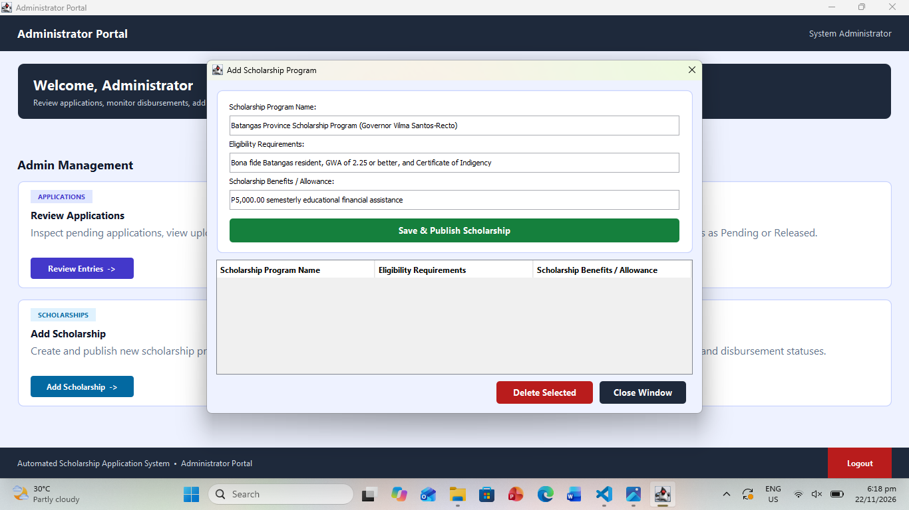
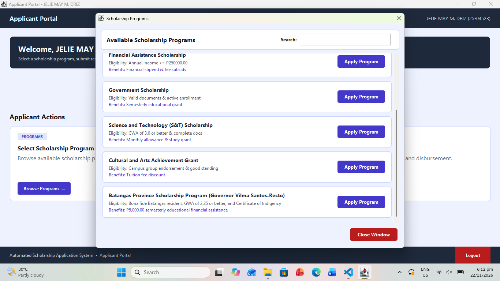

# Automated Scholarship Application, Document Validation, and Disbursement Monitoring System

---

## Project Overview
&nbsp;&nbsp;&nbsp;&nbsp;&nbsp;&nbsp;&nbsp;&nbsp;&nbsp;&nbsp;&nbsp;&nbsp;The proposed **Automated Scholarship Application, Document Validation, and Disbursement Monitoring System** streamlines the application process through a structured Java-based application. It automates requirement validation against predefined criteria and maintains systematic disbursement logs to ensure accurate, transparent, and prompt distribution of educational assistance. 

---

## Statement of the Problem
> &nbsp;&nbsp;&nbsp;&nbsp;&nbsp;&nbsp;&nbsp;&nbsp;&nbsp;&nbsp;&nbsp;&nbsp;Manual processing of scholarship applications is labor-intensive and prone to human error. Relying on paper-based records and unorganized digital folders often leads to:
> - Misplaced or lost supporting documents
> - Duplicate scholarship submissions
> - Delayed verification of applicant eligibility
> - Inaccurate or imprecise tracking of stipend disbursements

---

## Objectives of the Study
> &nbsp;&nbsp;&nbsp;&nbsp;&nbsp;&nbsp;&nbsp;&nbsp;&nbsp;&nbsp;&nbsp;&nbsp;To develop a Java-based application that will automates scholarship application management, validates submitted supporting documents, and monitors allowance disbursements to maintain transparent and efficient scholarship records.
>
> The project aims to:
> -	To manage applicant profiles and application lifecycle tracking by recording the student details, the scholarship programs selected and tracking the real time status changes across all stages (Pending, Auto-Verified, Approved, Rejected). 
> -	To build an automated document validation and completeness checker engine which will check the submitted documents, GWA and income thresholds and flag any that are incomplete or invalid before they reach the admin for review. 
> -	To monitor the allowance disbursements by logging the payout details, amounts, transaction dates and balance status for accurate financial tracking. 
> -	To produce structured summaries and reports on student applications, document verification status and the historical disbursement log for admin purposes.

---

## Target Beneficiaries & System Roles
| Target User | System Usage |
| :--- | :--- |
| **Scholarship Applicants** | Submit personal details, choose a scholarship program, submit requirements, track validation progress, and view disbursement schedules. |
| **Scholarship Administrators / Staff** | Review automatically validated documents, confirm application approvals, generate summary reports, and record stipend disbursements. |

---

## System Functionalities
| Features | Description |
| :--- | :--- |
| **Applicant & Application Management:** | Allows applicants to select available scholarship programs and staff to manage applicant records and categories. |
| **Automated Document Validation:** | Programmatically checks document parameters (GWA, income caps, document completeness) against scholarship eligibility thresholds without manual calculation. |
| **Smart Completeness Checker:** | Automatically flags incomplete requirement sets before final review, preventing submission of invalid applications. |
| **Application Progress Tracker:** | Monitors real-time status transitions (`Submitted` → `Pending Verification` → `Verified` → `Approved` / `Rejected`). |
| **Automated Disbursement Monitoring:** | Logs stipend payout amounts, dates, and balance statuses while automatically highlighting pending or delayed disbursements. |
| **Summary & Reporting Module:** | Generates formatted summaries of applicants, document verification logs, and disbursement histories. |

---

## Technical Stack & Object-Oriented Architecture
- **Programming Language:** Java (JDK 17+)
- **Core Concepts:** Object-Oriented Programming (OOP), Java Collections Framework (`ArrayList`), File I/O
- **Tools & Version Control:** Git & GitHub, *[Ilagay ang IDE ninyo, hal. NetBeans / IntelliJ IDEA / VS Code]*

---

## Team Members and Roles
| No. | SR Code | Name | Role / Assigned Tasks |
| :---: | :---: | :--- | :--- |
| 1 | 25-05743 | **Babao, John Robert M.** | Leader, Programmer |
| 2 | 25-04523 | **Driz, Jelie May M.** | Documentation |
| 3 | 25-02583 | **Luna, Jovelyn** | System Outline |

---

## Object-Oriented Programming (OOP) Principles Applied
- **Classes and Objects:** Entities such as `Applicant`, `ScholarshipApplication`, `GovernmentDocument`, `Disbursement`, `ScholarshipManager`, and `Main` encapsulate individual records and system operations.
- **Methods:** Operational logic is modularized into methods like `validateDocument()`, `updateStatus()`, `recordDisbursement()`, and `generateSummary()`.
- **Encapsulation:** Sensitive fields (such as student `gwa`, household income, and disbursement `amount`) are declared `private` and accessed strictly through getters and setters.
- **Inheritance:** AcademicRecord, IncomeCertificate, and IdentificationDocument inherit common attributes and methods from GovernmentDocument.
- **Polymorphism:** Method overriding allows different document classes to implement their own validateDocument() logic, while method overloading allows searchApplicant() to search using different parameters.
- **Abstraction:** Internal document checking and tracking algorithms are hidden behind clean, menu-driven user interfaces.
- **Exception Handling:** Uses `try-catch` blocks to catch invalid user inputs, non-numeric entries, and out-of-bounds menu selections.
- **Arrays / Data Handling:** Utilizes `ArrayList` to dynamically store, search, filter, and generate reports from records.

---

## Installation & Execution Guide
1. Ensure **Java Development Kit (JDK)** is installed on your computer.
2. Clone this repository:
   ```bash
   git clone [https://github.com/](https://github.com/)[username]/[repository-name].git

## System Interface & Workflow

### Applicant Module

<p align="center">
   
   <br>
  <em><strong>Figure 1.1: System Entry and Authentication Portal.</strong> Upon launching the application, users are presented with the role-based login interface and an option to register a new applicant account.</em>
</p>

<br>

<p align="center">
   
   <br>
  <em><strong>Figure 1.2: Applicant Account Registration Modal.</strong> New users without existing credentials can create an account by providing their full name, student/applicant ID, contact details, address, and login credentials.</em>
</p>

<br>

<p align="center">
   
   <br>
  <em><strong>Figure 1.3: Applicant Authentication.</strong> Once registration is complete, the applicant logs into the system using their registered username and password under the Applicant role.</em>
</p>

<br>

<p align="center">
   
   <br>
  <em><strong>Figure 1.4: Applicant Portal Dashboard.</strong> The main dashboard provides applicants with quick access to browse available scholarship programs and monitor their real-time application and disbursement status.</em>
</p>

<br>

<p align="center">
   
   <br>
  <em><strong>Figure 1.5: Scholarship Program Catalog.</strong> Applicants can search and review available grants—including eligibility criteria and benefits—before proceeding with an application.</em>
</p>

<br>


<p align="center">
   
   <br>
  <em><strong>Figure 1.6: Scholarship Application Submission Form.</strong> Applicants select their desired program, input academic and financial details (GWA and annual income), and upload supporting documents (.pdf, .jpg, or .png).</em>
</p>

<br>

### Administrator Module

<p align="center">

   <br>
   <em><strong>Figure 2.1: Administrator Authentication.</strong> System administrators access the management interface by selecting the Admin role on the main login portal.</em>
</p>

<br>

<p align="center">

   <br>
  <em><strong>Figure 2.2: Administrator Portal Dashboard.</strong> The central management hub enabling administrators to review applications, monitor fund disbursements, add new scholarship programs, and generate system reports.</em>
</p>

<br>

<p align="center">

   <br>
  <em><strong>Figure 2.3: Application Review and Validation.</strong> Administrators inspect submitted applicant details, verify uploaded supporting documents, and approve or reject scholarship entries.</em>
</p>

<br>

<p align="center">

   <br>
  <em><strong>Figure 2.4: Scholarship Program and Disbursement Management.</strong> Interface for configuring new scholarship grants and tracking allowance release statuses (Pending or Released).</em>
</p>

<br>

<p align="center">


<br>
  <em><strong>Figure 2.5: Summary Reports and Monitoring.</strong> Displays consolidated system records covering total applications, applicant eligibility, and overall disbursement summaries.</em>
</p>

<br>

## Scope and Limitations

- Standalone Architecture: The application operates as a local desktop Java program rather than a cloud-hosted web platform.
- Local Data Persistence: Records are maintained using in-memory data structures (ArrayList) and local file handling rather than a relational database management system (RDBMS).
- Manual Parameter Entry: Automated eligibility verification relies on user-entered academic (GWA) and financial (annual income) metrics rather than Optical Character Recognition (OCR) extraction from uploaded files.
- Simulated Disbursement Tracking: The disbursement module logs payout statuses and financial records for monitoring purposes and does not integrate with external banking or e-wallet payment gateways.

## Recommendations for Future Work

- Database Integration: Migrate data persistence to a relational database (e.g., MySQL or PostgreSQL) to support concurrent multi-user access and enhanced data integrity.
- OCR Document Parsing: Integrate Optical Character Recognition (OCR) libraries to automatically extract and cross-verify GWA and income figures directly from scanned PDFs and images.
- Web & Mobile Accessibility: Transition the system architecture into a full-stack web application to allow remote submission and real-time notifications across devices.
- Advanced Analytics & Export: Expand the reporting module to support exportable PDF/Excel audit sheets and visual data analytics.


## Research Team & Contributions

- **John Robert M. Babao** – Team Leader and Programmer
- **Jelie May M. Driz** – Documentation
- **Jovelyn Luna** – System Outline
