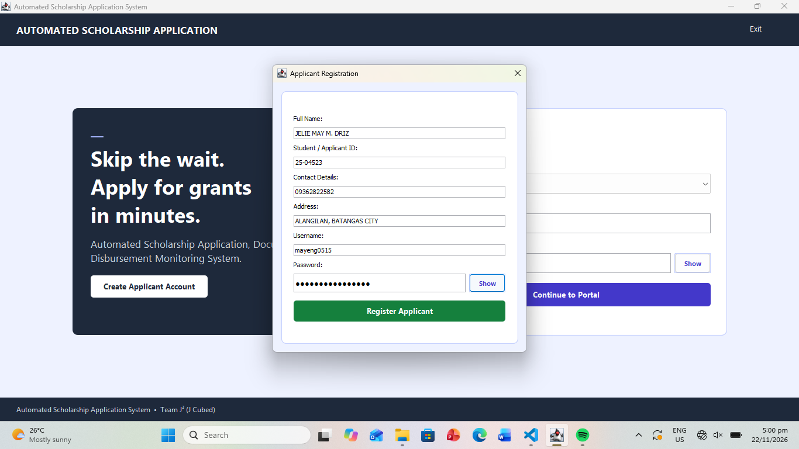

# Automated Scholarship Application, Document Validation, and Disbursement Monitoring System

---

## Project Description
&nbsp;&nbsp;&nbsp;&nbsp;&nbsp;&nbsp;&nbsp;&nbsp;&nbsp;&nbsp;&nbsp;&nbsp;The proposed **Automated Scholarship Application, Document Validation, and Disbursement Monitoring System** streamlines the application process through a structured Java-based application. It automates requirement validation against predefined criteria and maintains systematic disbursement logs to ensure accurate, transparent, and prompt distribution of educational assistance. 

---

## Problem Being Addressed
> &nbsp;&nbsp;&nbsp;&nbsp;&nbsp;&nbsp;&nbsp;&nbsp;&nbsp;&nbsp;&nbsp;&nbsp;Manual processing of scholarship applications is labor-intensive and prone to human error. Relying on paper-based records and unorganized digital folders often leads to:
> - Misplaced or lost supporting documents
> - Duplicate scholarship submissions
> - Delayed verification of applicant eligibility
> - Inaccurate or imprecise tracking of stipend disbursements

---

## Project Objectives
> &nbsp;&nbsp;&nbsp;&nbsp;&nbsp;&nbsp;&nbsp;&nbsp;&nbsp;&nbsp;&nbsp;&nbsp;To develop a Java-based application that will automates scholarship application management, validates submitted supporting documents, and monitors allowance disbursements to maintain transparent and efficient scholarship records.
>
> The project aims to:
> -	To manage applicant profiles and application lifecycle tracking by recording the student details, the scholarship programs selected and tracking the real time status changes across all stages (Pending, Auto-Verified, Approved, Rejected). 
> -	To build an automated document validation and completeness checker engine which will check the submitted documents, GWA and income thresholds and flag any that are incomplete or invalid before they reach the admin for review. 
> -	To monitor the allowance disbursements by logging the payout details, amounts, transaction dates and balance status for accurate financial tracking. 
> -	To produce structured summaries and reports on student applications, document verification status and the historical disbursement log for admin purposes.

---

## Target Users
| Target User | System Usage |
| :--- | :--- |
| **Scholarship Applicants** | Submit personal details, choose a scholarship program, submit requirements, track validation progress, and view disbursement schedules. |
| **Scholarship Administrators / Staff** | Review automatically validated documents, confirm application approvals, generate summary reports, and record stipend disbursements. |

---

## Main Features
| Features | Description |
| :--- | :--- |
| **Applicant & Application Management:** | Allows applicants to select available scholarship programs and staff to manage applicant records and categories. |
| **Automated Document Validation:** | Programmatically checks document parameters (GWA, income caps, document completeness) against scholarship eligibility thresholds without manual calculation. |
| **Smart Completeness Checker:** | Automatically flags incomplete requirement sets before final review, preventing submission of invalid applications. |
| **Application Progress Tracker:** | Monitors real-time status transitions (`Submitted` → `Pending Verification` → `Verified` → `Approved` / `Rejected`). |
| **Automated Disbursement Monitoring:** | Logs stipend payout amounts, dates, and balance statuses while automatically highlighting pending or delayed disbursements. |
| **Summary & Reporting Module:** | Generates formatted summaries of applicants, document verification logs, and disbursement histories. |

---

## Technologies Used
- **Programming Language:** Java (JDK 17+)
- **Core Concepts:** Object-Oriented Programming (OOP), Java Collections Framework (`ArrayList`), File I/O
- **Tools & Version Control:** Git & GitHub, *[Ilagay ang IDE ninyo, hal. NetBeans / IntelliJ IDEA / VS Code]*

---

## Team Members and Roles
| No. | SR Code | Name | Role / Assigned Tasks |
| :---: | :---: | :--- | :--- |
| 1 | 25-05743 | **Babao, John Robert M.** | Leader, Programmer |
| 2 | 25-04523 | **Driz, Jelie May M.** | Documentation |
| 3 | 25-02583 | **Luna, Jovelyn** | System Outline |

---

## OOP Concepts Demonstrated
- **Classes and Objects:** Entities such as `Applicant`, `ScholarshipApplication`, `GovernmentDocument`, `Disbursement`, `ScholarshipManager`, and `Main` encapsulate individual records and system operations.
- **Methods:** Operational logic is modularized into methods like `validateDocument()`, `updateStatus()`, `recordDisbursement()`, and `generateSummary()`.
- **Encapsulation:** Sensitive fields (such as student `gwa`, household income, and disbursement `amount`) are declared `private` and accessed strictly through getters and setters.
- **Inheritance:** AcademicRecord, IncomeCertificate, and IdentificationDocument inherit common attributes and methods from GovernmentDocument.
- **Polymorphism:** Method overriding allows different document classes to implement their own validateDocument() logic, while method overloading allows searchApplicant() to search using different parameters.
- **Abstraction:** Internal document checking and tracking algorithms are hidden behind clean, menu-driven user interfaces.
- **Exception Handling:** Uses `try-catch` blocks to catch invalid user inputs, non-numeric entries, and out-of-bounds menu selections.
- **Arrays / Data Handling:** Utilizes `ArrayList` to dynamically store, search, filter, and generate reports from records.

---

## Instructions for Running the Program
1. Ensure **Java Development Kit (JDK)** is installed on your computer.
2. Clone this repository:
   ```bash
   git clone [https://github.com/](https://github.com/)[username]/[repository-name].git

## Sample Screenshots 🖼





## Known Limitations

- The system operates as a desktop Java application with console- or GUI-based interaction.
- Data is stored using local data structures and file handling instead of an external database.
- Document validation requires manually entered information such as GWA and household income.
- The system does not support automatic document scanning or OCR.
- Disbursement monitoring only records transactions and does not process actual bank transfers.

## Future Improvements

- Integrate a database for more reliable and organized data storage.
- Implement OCR technology to automatically extract information from submitted documents.
- Develop a web-based version for easier access across different devices.
- Improve reporting features with more detailed summaries and statistics.


## Project Contributors

- **John Robert M. Babao** – Team Leader and Programmer
- **Jelie May M. Driz** – Documentation
- **Jovelyn Luna** – System Outline
